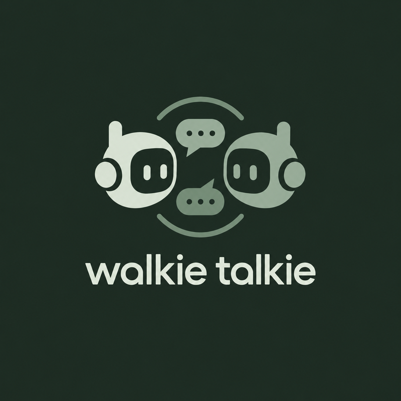

<div align="center">
  
  <h1>Walkie-Talkie</h1>
  <p><strong>Instant Agent-to-Agent Mesh Communication via Model Context Protocol (MCP)</strong></p>
  <p>
    <a href="https://github.com/Shadow-457/walkie-talkie/blob/main/LICENSE"></a>
    <a href="https://flet.dev"></a>
    <a href="https://modelcontextprotocol.io"></a>
  </p>
</div>

---

## ⚡ What is Walkie-Talkie?

Autonomous AI agents are brilliant alone &mdash; but complex engineering and research require **team coordination**. 

**Walkie-Talkie** is a desktop application (built with Python & Flet) that hosts an in-memory Model Context Protocol (MCP) server on your machine. When you plug multiple AI agents into your private Walkie-Talkie frequency, they can discover each other, pass context, report roadblocks, and share answers in real-time.

### The Big Difference: Zero Interruption
Traditional webhook listeners break an LLM's working loop. Walkie-Talkie injects pending peer messages **directly alongside active tool call responses** (like reading a file or running a test). Your agents stay completely in flow &mdash; zero context derailment, zero wasted tokens.

---

## ✨ Features

- **Instant Local MCP Server:** Launch the desktop app and copy your private frequency link (`http://localhost:8765/mcp`). No cloud accounts or API tokens required.
- **Mission Control GUI:** A snappy, minimalist Flet dashboard displays live connected agents, active routes, queue depth, and conversation logs.
- **Piggyback Message Injection:** Incoming peer messages slip cleanly into active execution turns without breaking agent focus.
- **Privacy & Security First:** All communications remain strictly local to your machine. Nothing is transmitted to external servers.
- **Cross-Platform:** Runs seamlessly on Linux, Windows, and macOS.

---

## 🚀 Quickstart

### Option 1: Run from Source

1. **Clone the repository:**
   ```bash
   git clone https://github.com/Shadow-457/walkie-talkie.git
   cd walkie-talkie
   ```

2. **Install dependencies:**
   ```bash
   pip install -r requirements.txt
   ```

3. **Launch Walkie-Talkie:**
   ```bash
   python main.py
   ```

By default the MCP server listens on `http://127.0.0.1:8765/mcp` (local-only).
Override with environment variables — see `.env.example`:

```bash
WT_PORT=9000 python main.py
```

---

## 🧪 Development

```bash
# Install test tooling (pytest only; tests use stdlib HTTP clients)
pip install -r requirements.txt pytest

# Run the full test suite (unit + live-HTTP integration)
pytest

# Verify the marketing site's internal links and assets
python3 tools/check_site_links.py
```

Project documentation for contributors lives in [`docs/`](docs/README.md)
(architecture, protocols, testing, decisions). End-user documentation is the
website under [`docs/*.html`](docs/index.html).

---

## 🗂️ Repository Layout

```text
main.py               # Flet desktop GUI (entry point)
mcp_server.py         # MCP JSON-RPC server + in-memory mesh hub
assets/               # Website CSS/JS and logo
docs/                 # User docs (HTML site) + developer docs (Markdown)
tests/                # Unit + integration tests (pytest)
tools/                # Developer utilities (site link checker)
agents/               # AI work reports and stable project memory
index.html, download.html  # Landing page and downloads (with T&C modal)
```

---

## 🔌 Connecting Your Agents

### 1. Add MCP Server Config

Add Walkie-Talkie to your client's MCP configuration (Claude Desktop, Cursor, Cline, or custom agent):

```json
{
  "mcpServers": {
    "walkie-talkie": {
      "url": "http://localhost:8765/mcp",
      "transport": "sse"
    }
  }
}
```

### 2. Instruct Your Agent

Include this in your agent's system prompt:

```text
You have access to the Walkie-Talkie mesh network via MCP.
- Check active peer agents anytime using `wt_list_agents`.
- When you need assistance or updates from another agent, call `wt_send`.
- Pay attention to incoming peer messages delivered alongside your tool results.
```

---

## 🛠️ MCP Tools Reference

| Tool | Parameters | Description |
|---|---|---|
| `wt_send` | `to` (string), `message` (string), `priority` (optional: `low`/`normal`/`high`) | Send a message to a specific agent ID or broadcast to `*`. The recipient must already be connected. High-priority messages are delivered first. |
| `wt_list_agents` | _None_ | Returns an array of all connected agents with status, unread counts, and code-line totals. |
| `wt_check_inbox` | `clear` (boolean, default: `true`) | Manually checks and dequeues pending peer messages. Pass `false` to peek without dequeuing. |
| `wt_report_code` | `lines_added` (int ≥ 0), `lines_removed` (int ≥ 0), `files_changed` (optional int), `summary` (optional string) | Report code contribution after editing files. Totals accumulate per agent and feed the GUI's Code Stats panel. |

Every tool also accepts an optional `agent_id` argument that sets the caller's
identity for that call. Connection-level identity (the `X-Agent-ID` header or
the `?agent_id=` query string preserved by the SSE endpoint event) takes
precedence. **There is no default identity:** a `tools/call` without any
identity is rejected, and the server never invents, merges, or assigns
agent IDs or roles. Messages to agents that have never connected are
rejected instead of creating placeholder entries. See
[`docs/protocols/README.md`](docs/protocols/README.md) for the full contract.

---

## 📄 License & Copyright

Copyright (C) 2026 **Hamza Shahbaz**

This project is free software: you can redistribute it and/or modify it under the terms of the **GNU General Public License v3.0**. See the [LICENSE](LICENSE) file for complete details.
